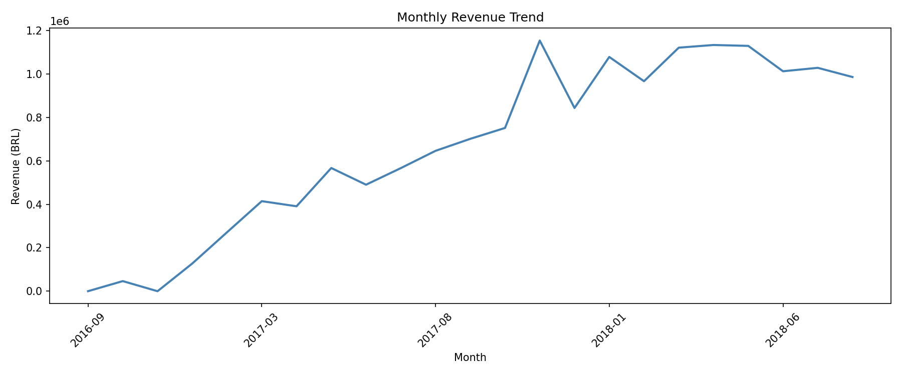
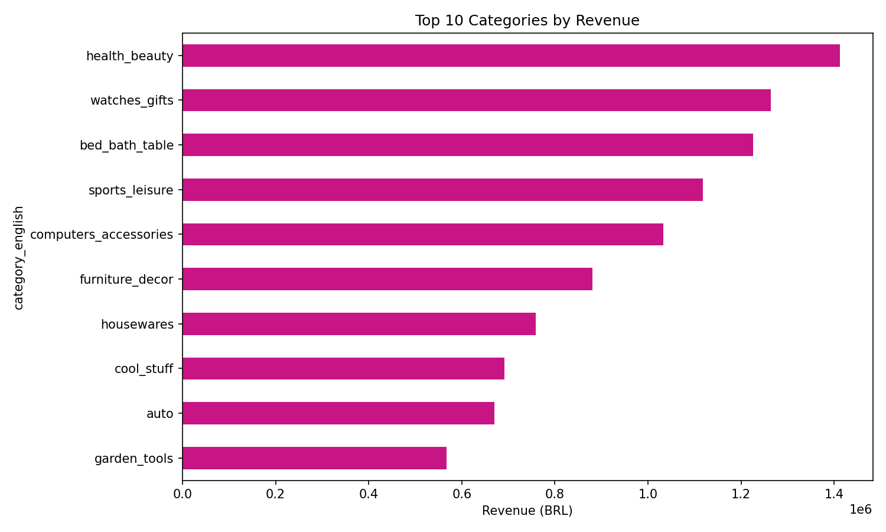
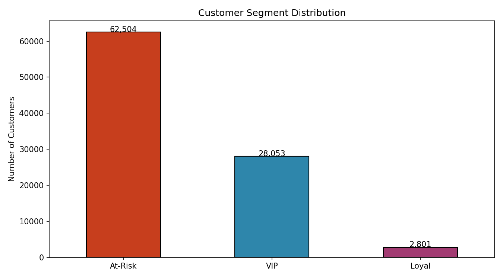
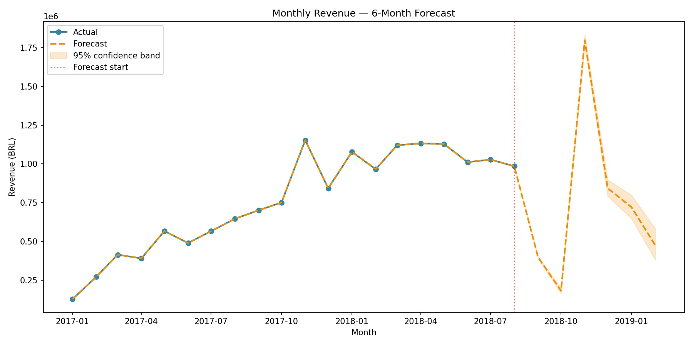

# Brazilian E-Commerce Sales Analytics

An end-to-end analytics project built around the Brazilian e-commerce dataset published by Olist. It turns order, product, customer, and payment data into a cleaned sales table, exploratory analysis, SQL business metrics, customer segments, a revenue forecast, and a Power BI report.

The project is intended as a reproducible portfolio and learning project. The analysis uses historical marketplace data; it is not a live reporting system.

## At a glance

- **Data:** Olist Brazilian E-Commerce Public Dataset
- **Analysis:** Python, pandas, SQLite, and SQL
- **Customer analytics:** RFM features and K-means clustering
- **Forecasting:** Prophet monthly revenue forecast
- **Reporting:** Power BI dashboard and saved charts/CSV results
- **Currency:** Brazilian real (BRL)

## What you can explore

The project answers questions such as:

- How does revenue change by month, quarter, and year?
- Which product categories, products, and states contribute the most revenue?
- What are the average order value and repeat-customer patterns?
- How do customers differ by recency, order frequency, and spend?
- What might monthly revenue look like over the next six months?

The SQL analysis also includes an ABC product classification. See the saved query results in [`docs/sql_results/`](docs/sql_results/).

## Example visualizations

### Monthly revenue



### Revenue by product category



### Customer segments



### Revenue forecast



## Repository layout

```text
.
├── data/
│   ├── master.csv                         # Prepared, item-level analysis table
│   └── olist_*.csv                        # Source dataset tables
├── docs/
│   ├── forecast/                          # Forecast CSV and chart
│   ├── segmentation/                      # RFM output tables and charts
│   ├── sql_results/                       # Exported SQL query results
│   └── chart_*.png                         # EDA charts
├── powerbi/
│   └── dashboard.pbix                     # Power BI report
├── python/
│   ├── 01_data_cleaning.ipynb
│   ├── 02_sql_setup.ipynb
│   ├── 03_eda.ipynb
│   ├── 04_sql_queries.ipynb
│   ├── 05_rfm_segmentation.py
│   └── 06_forecasting.py
├── sql/
│   └── olist.db                            # SQLite database (generated locally)
├── requirements.txt
└── README.md
```

## Data source

This project uses the [Brazilian E-Commerce Public Dataset by Olist](https://www.kaggle.com/datasets/olistbr/brazilian-ecommerce). The source CSV files are in `data/`. The prepared `data/master.csv` is the main input to the analysis scripts.

## Getting started

### Requirements

- Python 3.9 or later
- Jupyter Notebook or JupyterLab to run the `.ipynb` workflow
- Power BI Desktop to open and interact with the `.pbix` report

Install the Python dependencies from the repository root:

```bash
python -m venv .venv
```

Activate the environment:

```bash
# Windows PowerShell
.\.venv\Scripts\Activate.ps1

# macOS / Linux
source .venv/bin/activate
```

Then install dependencies:

```bash
python -m pip install --upgrade pip
pip install -r requirements.txt
```

To run the notebooks, install Jupyter if it is not already available in your environment:

```bash
pip install jupyter
```

## Reproduce the analysis

Run the notebooks in order. Their relative data paths expect the notebook kernel's working directory to be `python/`; in VS Code, open the notebook from that folder and select the environment created above.

1. **Prepare the analysis table:** run `python/01_data_cleaning.ipynb`. This filters to delivered orders, parses dates, translates product categories, joins the source tables, and writes `data/master.csv`.
2. **Create the SQLite database:** run `python/02_sql_setup.ipynb`. This creates `sql/olist.db` with `sales`, `customers`, and `products` tables.
3. **Explore the data:** run `python/03_eda.ipynb`. This creates the charts in `docs/`.
4. **Export SQL metrics:** run `python/04_sql_queries.ipynb`. This writes query results to `docs/sql_results/`.
5. **Segment customers:** from the repository root, run:

   ```bash
   python python/05_rfm_segmentation.py
   ```

6. **Forecast revenue:** from the repository root, run:

   ```bash
   python python/06_forecasting.py
   ```

The segmentation and forecasting scripts expect `data/master.csv` to exist. If you regenerate it, run the cleaning notebook first. The scripts resolve their input and output paths relative to their own files, so run them from the repository root as shown (or from another working directory).

Open `powerbi/dashboard.pbix` in Power BI Desktop to explore the report. If you regenerate or move the source data, update the report's data source in Power BI as needed.

## Analysis details

### Data preparation

The cleaning notebook keeps delivered orders with a valid purchase timestamp, translates product category names where a translation is available, and joins order items with order, customer, product, and payment data. The resulting master table is at item level.

`revenue` is defined in the notebook as item price plus freight value. `profit` is an illustrative estimate calculated as 20% of item price; it is an assumption, not actual margin or accounting profit. Payment totals are also retained in the master table as an order-level field.

### SQL metrics

The SQL notebook saves these results as numbered CSV files in `docs/sql_results/`:

- Total and monthly revenue
- Top categories, products, states, and customers
- Average order value and year-over-year growth
- Repeat-customer analysis
- Quarterly revenue
- ABC classification

### Customer segmentation

The RFM script aggregates customers using:

- **Recency:** days since the customer's most recent order
- **Frequency:** number of distinct orders
- **Monetary:** summed item-level revenue

It caps monetary outliers at the 99th percentile for clustering, log-transforms frequency and monetary values, standardizes the features, and applies K-means with four clusters. The cluster labels (VIP, Loyal, Regular, and At-Risk) are assigned heuristically from spend and recency; they are descriptive labels, not independently validated customer types.

Outputs in `docs/segmentation/`:

- `rfm_segments.csv` and `cluster_summary.csv`
- `segment_distribution.png`, `segment_revenue.png`, and `rfm_scatter.png`

### Revenue forecast

The forecasting script aggregates revenue by month and trains Prophet on the complete months from January 2017 through August 2018, then generates six future monthly predictions. It saves `forecast_6_months.csv` and `forecast_chart.png` in `docs/forecast/`.

The script also reports MAPE calculated against predictions for the same historical period used to fit the model. This is an **in-sample** metric, not a holdout or backtest result, so it should not be treated as an unbiased estimate of future accuracy. The dataset is historical and the forecast is an exploratory baseline, not financial guidance.

## Dependencies

The versions in `requirements.txt` are minimums:

- pandas
- NumPy
- Matplotlib
- Seaborn
- scikit-learn
- Prophet

SQLite is provided by Python's standard library. Jupyter and Power BI Desktop are separate tools; Power BI Desktop is only needed to open the report.

## Notes and limitations

- Results reflect the source dataset and the preparation choices in the notebooks; they are not real-time.
- Product category translation may be unavailable for some products, which are labeled `unknown`.
- The estimated `profit` field uses a fixed 20% margin assumption and must not be interpreted as actual profit.
- Forecast uncertainty and the short historical time series limit how confidently the predictions can be used.
- `sql/olist.db` is generated by the SQL setup notebook and is ignored by Git; recreate it by running that notebook.

## License and attribution

The repository does not declare a separate software license. The dataset is provided by Olist; refer to the [dataset page](https://www.kaggle.com/datasets/olistbr/brazilian-ecommerce) and its terms for source-data attribution and usage conditions.
